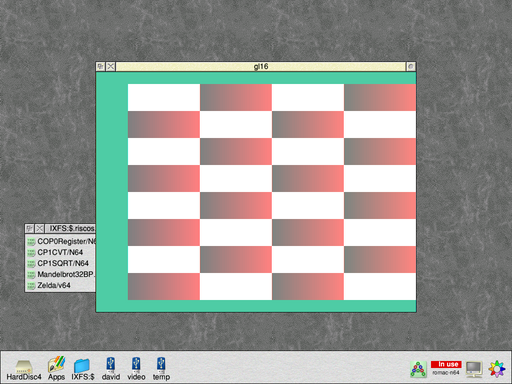

# Mupen64Plus (N64 emulator) on RISC3D 0.17: how it behaves, and what we saw

For Andrew Youll, from the riscos-mupen64plus port. 23 November 2026.

Mupen64Plus 2.6.0, with the Rice video plugin, runs on RISC OS 5 as a desktop app, drawing
through RISC3D. On a native Raspberry Pi 4 with **RISC3D 0.17 (RISC3D 0.09, V3DRender 0.26)** it
runs Super Mario 64 on the GPU at well over the N64's full speed.

Summary for RISC3D's author, all three ports:
[RISC3D-for-Andy.md](https://github.com/davidpsharp/riscos-dhewm3/blob/main/docs/RISC3D-for-Andy.md).
This file is the Mupen64Plus evidence; its item 1 (16 bpp) is new: **a 16 bpp (64K colour)
desktop shows every GL window garbled**. The V3DRender items the emulator also meets are under
[Also seen](#also-seen).

## Status, 26 November 2026: RISC3D 0.22 and riscos-mesa 20.3.5-23

Release 0.2.0 is built with the -23 devkit (a plain rebuild, no code changes) and was retested on
pi4-socrates with RISC3D 0.22 (RISC3D 0.11, V3DRender 0.37):

| # | Issue | Now |
|---|---|---|
| 1 | 64K colour desktops garble the GL window | **Still there** with -23: gl16 in 1280x800 RGB565 shows 4 squares across, striped. Expected to be fixed in -24 |
| 2 | 128 MB cap without !MesaLibs | **Fixed.** With only !RISC3D 0.22 in `!Boot.Resources` (no !MesaLibs), Mario runs on the GPU at 164.5 VI/s; `*V3DRender` shows 262,144 KB of buffer memory, 0 resets, 0 MMU errors, 0 timeouts, 0 binner overflows, and no files open after quitting |
| 3 | 4,096 buffer handles | Fixed in V3DRender 0.37 (tables grow to 65,535). Never hit by the emulator |
| 4 | Moved pages | Still not hit |

The frame at VI 120 is identical to RoMac's and to earlier runs (framebuffer hash `85476dc5`).
The app's `!Help` and the README now ask for RISC3D 0.22 or later on a Pi 4, and no longer for
!MesaLibs.

## What we ran

- **The emulator:** Mupen64Plus 2.6.0 (core, Rice video, RSP HLE, SDL audio and input), built
  as one static program with riscos-crossdev 1.11 (GCC 10.2) and riscos-mesa's devkit
  20.3.5-22, linked with `-lMesaGPU`. The new_dynarec ARMv7 recompiler. Rice asks for an OpenGL
  context through SDL 2: 32-bit colour, 16-bit depth, double buffered.
- **The binaries:** the [v0.1.0 release](https://github.com/davidpsharp/riscos-mupen64plus/releases/tag/v0.1.0),
  `riscos-mupen64plus-0.1.0.zip`. It's a RISC OS zip that keeps file types, and holds:
  - `!Mupen64Plus`, the app. It sits on the icon bar; drop a ROM on it. It needs !RISC3D and
    !MesaLibs in `!Boot.Resources`, SharedUnixLibrary and ARMEABISupport.
  - `Tests.gl16`, the GL test program for item 1, and `RunGL16` to run it.

  No ROMs are included; Super Mario 64 was our test game.
- **Machines:**
  - **pi4-socrates:** Raspberry Pi 4, RISC OS 5.30 (15 May 2024), ARM at 1500 MHz.
    RISC3D-0.09-1.zip's `!RISC3D` and the devkit's `!MesaLibs` were installed in
    `!Boot.Resources`, then the Pi was restarted.
  - **pi4-plato:** the same kind of Pi 4. Used for the 0.16 runs.
  - **RoMac:** RISC OS 5.31 on an M3 Pro Mac, RISC3D through Linux3D.
- **The runs:** Super Mario 64's intro and title, 4,000 VIs (the N64's frames), with the speed
  limiter off, so VI/s shows the headroom. The N64's full speed is 60 VI/s.

## How it runs

| Pi 4 | VI/s, limiter off | Buffer errors | `*V3DRender` afterwards |
|---|---|---|---|
| 0.16, software Mesa (`LIBGL_ALWAYS_SOFTWARE`) | 12-15 | — | — |
| 0.16 on the GPU, !MesaLibs in Resources (plato) | 154 | 0 | 0 resets, 0 MMU errors |
| **0.17 on the GPU, !MesaLibs in Resources (socrates)** | **163-169** | **0** | 0 resets, 0 MMU errors; 224 buffers made, 26 entirely from kept pages |

So on the GPU the Pi 4 runs this game at well over the N64's full speed.

## 1. 64K colour desktops: the GL window shows the wrong pixels (new)

**Seen:** in a 16 bpp (64K colour) desktop mode, Mupen64Plus's window shows nonsense: textures
look like noise and the picture looks too big. The same build in a 16M colour mode is perfect.

| | 16M colours | 64K colours |
|---|---|---|
| Pi 4, V3DRender 0.26 | right | wrong |
| Pi 4, V3DRender 0.16 | right | wrong |
| Pi 4, software Mesa | right | wrong |
| RoMac (Linux3D) | right | wrong |

Because it's the same on every GL route, it isn't in V3DRender or Linux3D. Rice never looks at
the desktop's depth either; it always asks for 32-bit colour.

**A small test program, `gl16`** (`riscos/probe/gl16.c`; `Tests.gl16` in the release), takes
the emulator out of it:
- it opens a 640x480 SDL window with a GL context, asking for the same attributes as Rice;
- it draws one textured quad, 32-pixel red and white squares (8 across, 8 down), with the red
  going to magenta from left to right, on a blue clear colour (0.2, 0.3, 0.5);
- it checks guard blocks on the heap after every frame. In 3,000 frames there was no
  corruption, so it isn't a stray write into the program's memory.

On RoMac (GL renderer "Apple M3 Pro (RISC3D, Linux GPU)"):

| 16M colours (`BGR888`): right | 64K colours (`BGR565`), the default EGL path |
|---|---|
|  |  |

**What the 64K picture is:** only **4** squares across instead of 8, so the window shows the
**left half** of the frame at **double width**, and neighbouring screen pixels alternate between
two colours.

**The screen's own memory confirms it** (`*ScreenSave` on the Pi 4, V3DRender 0.26, desktop
1280x800 RGB565, so no screenshot decoding is involved). The gl16 window's background pixels
are the 16-bit values **&4C33** and **&FF80**, alternating. The clear colour (0.2, 0.3, 0.5)
as a 32-bit pixel is **&FF804C33**: those are its low and high halves. So **each 32-bit pixel of
the GL frame is written to the 16 bpp screen as two 16-bit pixels, unconverted**: the frame is
copied byte for byte into a window with 2 bytes a pixel. RoMac's 64K screenshots show the same
pairs.

With `SDL_RISCOS_GL_EGL 0`, or with `LIBGL_ALWAYS_SOFTWARE 1`, the pixel pairs go away, but the
picture is still the left half at double width, and its colours are wrong. We didn't check that
path's colours in screen memory, because ro-run's screenshots of 16 bpp desktops don't decode
colours reliably.

**The sprite path has a candidate fix.** The riscos-half-life port (Xash3D) found that SDL's
OSMesa sprite path (`SDL_riscosopengl.c`) renders a 32 bpp type 6 sprite and plots it on a 16 bpp
desktop with no translation table. Its SDL patch `09-gl-in-64k-colour-modes.patch` renders
`OSMESA_RGB_565` straight into a sprite in the screen's own mode in RGB565 modes, and it checked
the patch on this Pi at 64K. The EGL path (RISC3D) needs its own fix: there, the 32-bit pixels
are copied raw.

**Where we think it is:**
- With RISC3D: riscos-mesa's EGL window surface (`eglRedrawWindowRISCOS` and the swap). It copies
  4-byte pixels into a 2-byte-a-pixel window without converting them.
- The sprite path: SDL's `SDL_riscosopengl.c`, as above.

We haven't read riscos-mesa's EGL source, so the EGL half of this is from the outside.

**To reproduce:** `*WimpMode X1024 Y768 C64K`, then double-click `Tests.RunGL16`. Compare with
`C16M`. `Tests.gl16out` records the pixel format SDL reports, the renderer, and any heap
corruption it found.

**Not just this program:** the riscos-dhewm3 port sees the same on RoMac at 1024x768 in 64K
colours. Doom 3's main menu shows the left half at double width, with both its own patched SDL
and the devkit's stock libSDL2.a.

**Workaround for users:** a 16M colour desktop. The app's `!Help` will say so.

## Also seen

- **The 128 MB cap** ([Doom 3 §2](https://github.com/davidpsharp/riscos-dhewm3/blob/main/docs/RISC3D-0.17-report.md#2-the-128-mb-dynamic-area-cap-still-an-issue-though-boot-order-can-hide-it)):
  it crashes the emulator the same way. Each case from a clean restart:

  | | !MesaLibs in `!Boot.Resources` | !MesaLibs moved out |
  |---|---|---|
  | 0.16 (plato) | GPU, 154 VI/s, 0 buffer errors | "MESA: error: Failed to allocate device memory for BO" (5 times), then a data abort reading address 0 (at &0132C9FC in the program) |
  | 0.17 (socrates) | GPU, 169 VI/s, 0 buffer errors | the same: 5 "Failed to allocate device memory for BO", then the same data abort |

  A user who installs only !RISC3D, enough for a statically linked program like this, meets
  the crash.
- **Handles** ([Doom 3 §1](https://github.com/davidpsharp/riscos-dhewm3/blob/main/docs/RISC3D-0.17-report.md#1-buffer-handles-4096-per-file-is-too-few-the-blocker)): not
  hit. Mario's title and intro made 224 buffers in all.
- **Moved pages** ([Doom 3 §3](https://github.com/davidpsharp/riscos-dhewm3/blob/main/docs/RISC3D-0.17-report.md#3-hangs-and-the-frozen-window-fixed-by-023)): not hit. No
  hangs, resets or MMU errors with 0.16 or 0.17.

## Smaller things

- **A refused buffer crashes rather than failing** (Doom 3 §5): with the cap in place, the
  emulator dies with a data abort at address 0 just after the "Failed to allocate" messages.
- **A clean restart doesn't load ARMEABISupport.** A program started before anything else has
  loaded it fails with "SWI &59D01 not known". Our app's `!Run` loads it; this only bit our
  test scripts. Not RISC3D's, but worth a line in its docs for program authors.
- **The release zip itself:** `!Mupen64Plus` from `riscos-mupen64plus-0.1.0.zip`, started
  through its own Game file, plays Super Mario 64 on pi4-socrates's GPU with 0.17 in a 16M
  colour desktop (0 resets, 0 MMU errors).
- Rice's request for a 16-bit depth buffer gets 24 bits on V3D ("Failed to set GL_DEPTH_SIZE to
  16. (it's 24)"). That's harmless; noted in case it matters elsewhere.

## Not yet tried

- RISC OS on Linux on a Pi 5 (pi5-octagon), which needs a 4 KB-page kernel there first.
- GLideN64, the other N64 video plugin, which needs OpenGL ES 3 contexts.
- 0.17's desktop 2D on the GPU (`*V3DRender 2D on`) with the emulator running.

## Source

This repository: the emulator's build (`CMakeLists.txt`, `riscos/`), the app, the test hooks
(`src/n64_check.c`), and `riscos/probe/gl16.c`. Mupen64Plus is GPL-2.0, and so is this port.
