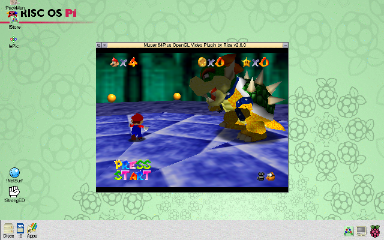
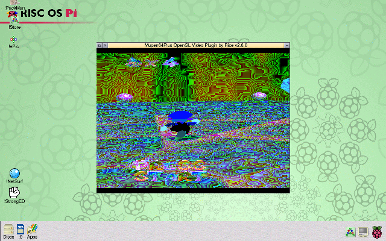
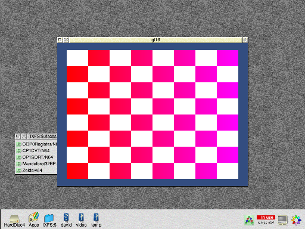
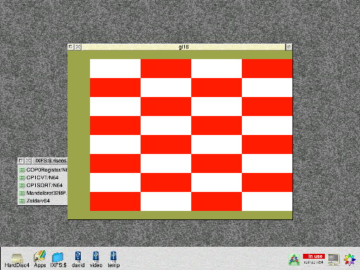

# Mupen64Plus (N64 emulator) on RISC3D 0.17: how it behaves, and what we saw

For Andrew Youll, from the riscos-mupen64plus port. 23 November 2026.

Mupen64Plus 2.6.0, with the Rice video plugin, runs on RISC OS 5 as a desktop app, drawing
through RISC3D. On a native Raspberry Pi 4 with **RISC3D 0.17 (RISC3D 0.09, V3DRender 0.26)** it
runs Super Mario 64 on the GPU at well over the N64's full speed.

The riscos-dhewm3 (Doom 3) port has written up the V3DRender items in detail:
[its RISC3D 0.17 report](https://github.com/davidpsharp/riscos-dhewm3/blob/main/docs/RISC3D-0.17-report.md).
This report doesn't repeat them. It adds what is different for the emulator, and one new issue:
**a 16 bpp (64K colour) desktop shows every GL window garbled** (item 1 below).

## Summary

| # | Issue | Where | Effect on Mupen64Plus |
|---|---|---|---|
| 1 | In a 64K colour (16 bpp) desktop, a GL window shows the left half of the frame stretched to the full width, with wrong colours | riscos-mesa's SDL / EGL window code (devkit 20.3.5-22) | Unplayable in 64K colours; fine in 16M colours. Seen on the Pi 4 GPU, Pi 4 software Mesa, and RoMac |
| 2 | V3DRender's buffer area is capped at 128 MB unless DAClamp runs first | V3DRender / !RISC3D | Every buffer of 64 KB+ refused, then a crash. Same in 0.16 and 0.17. Works when !MesaLibs is in `!Boot.Resources` |
| 3 | 4,096 buffer handles per file | V3DRender | Not hit (Mario makes ~224 buffers) |
| 4 | Imported memory moved under the GPU (hangs, frozen window) | V3DRender | Not hit with 0.16 or 0.17 |

Items 2 to 4 are the Doom 3 report's
[§2](https://github.com/davidpsharp/riscos-dhewm3/blob/main/docs/RISC3D-0.17-report.md#2-the-128-mb-dynamic-area-cap-still-an-issue-though-boot-order-can-hide-it),
[§1](https://github.com/davidpsharp/riscos-dhewm3/blob/main/docs/RISC3D-0.17-report.md#1-buffer-handles-4096-per-file-is-too-few-the-blocker)
and
[§3](https://github.com/davidpsharp/riscos-dhewm3/blob/main/docs/RISC3D-0.17-report.md#3-hangs-and-the-frozen-window-fixed-by-023).

## What we ran

- **The emulator:** Mupen64Plus 2.6.0 (core, Rice video, RSP HLE, SDL audio and input), built
  as one static program with riscos-crossdev 1.11 (GCC 10.2) and riscos-mesa's devkit
  20.3.5-22, linked with `-lMesaGPU`. The new_dynarec ARMv7 recompiler. Rice asks for an OpenGL
  context through SDL 2: 32-bit colour, 16-bit depth, double buffered.
- **The binaries:** the [v0.1.0 release](https://github.com/davidpsharp/riscos-mupen64plus/releases/tag/v0.1.0),
  `riscos-mupen64plus-0.1.0.zip`. It's a RISC OS zip that keeps file types, and holds:
  - `!Mupen64Plus`, the app. It sits on the icon bar; drop a ROM on it. It needs !RISC3D and
    !MesaLibs in `!Boot.Resources`, SharedUnixLibrary and ARMEABISupport.
  - `Tests.gl16`, the GL test program for item 1, and `RunGL16` to run it.

  No ROMs are included; Super Mario 64 was our test game.
- **Machines:**
  - **pi4-socrates:** Raspberry Pi 4, RISC OS 5.30 (15 May 2024), ARM at 1500 MHz.
    RISC3D-0.09-1.zip's `!RISC3D` and the devkit's `!MesaLibs` were installed in
    `!Boot.Resources`, then the Pi was restarted.
  - **pi4-plato:** the same kind of Pi 4. Used for the 0.16 runs.
  - **RoMac:** RISC OS 5.31 on an M3 Pro Mac, RISC3D through Linux3D.
- **The runs:** Super Mario 64's intro and title, 4,000 VIs (the N64's frames), with the speed
  limiter off, so VI/s shows the headroom. The N64's full speed is 60 VI/s.

## How it runs

| Pi 4 | VI/s, limiter off | Buffer errors | `*V3DRender` afterwards |
|---|---|---|---|
| 0.16, software Mesa (`LIBGL_ALWAYS_SOFTWARE`) | 12-15 | — | — |
| 0.16 on the GPU, !MesaLibs in Resources (plato) | 154 | 0 | 0 resets, 0 MMU errors |
| **0.17 on the GPU, !MesaLibs in Resources (socrates)** | **163-169** | **0** | 0 resets, 0 MMU errors; 224 buffers made, 26 entirely from kept pages |

So on the GPU the Pi 4 runs this game at well over the N64's full speed.

## 1. 64K colour desktops: the GL window shows the wrong pixels (new)

**Seen:** in a 16 bpp (64K colour) desktop mode, Mupen64Plus's window shows nonsense: textures
look like noise and the picture looks too big. The same build in a 16M colour mode is perfect.

| | 16M colours | 64K colours |
|---|---|---|
| Pi 4, V3DRender 0.26 | right | wrong |
| Pi 4, V3DRender 0.16 | right | wrong |
| Pi 4, software Mesa | right | wrong |
| RoMac (Linux3D) | right | wrong |

Because it's the same on every GL route, it isn't in V3DRender or Linux3D. Rice never looks at
the desktop's depth either; it always asks for 32-bit colour.

**A small test program, `gl16`** (`riscos/probe/gl16.c`; `Tests.gl16` in the release), takes
the emulator out of it:
- it opens a 640x480 SDL window with a GL context, asking for the same attributes as Rice;
- it draws one textured quad, 32-pixel red and white squares (8 across, 8 down), with the red
  going to magenta from left to right, on a blue clear colour (0.2, 0.3, 0.5);
- it checks guard blocks on the heap after every frame. In 3,000 frames there was no
  corruption, so it isn't a stray write into the program's memory.

On RoMac (GL renderer "Apple M3 Pro (RISC3D, Linux GPU)"):

| 16M colours (`BGR888`): right | 64K colours (`BGR565`), the default EGL path |
|---|---|
|  |  |

**What the 64K picture is:** only **4** squares across instead of 8, so the window shows the
**left half** of the frame at **double width**. Neighbouring screen pixels alternate between two
colours. The background's pixels, read from a full-size screenshot, alternate between
(156, 165, 74) and (0, 242, 255). The clear colour (51, 77, 128) is the 32-bit word
&FF804D33. Its low half &4D33 and high half &FF80, each decoded as a BGR565 pixel, are exactly
those two colours. **So each 32-bit pixel of the GL frame lands on the screen as two 16-bit
pixels, unconverted**: the frame is copied byte for byte, at 2 bytes a pixel, into a 16 bpp
window.

With `SDL_RISCOS_GL_EGL 0`, or with `LIBGL_ALWAYS_SOFTWARE 1`, the pixel pairs go away, but the
picture is still the left half at double width. It's also tinted wrong: the background is teal
and the red squares go from grey to pink.

**Where we think it is:** the code that puts a GL frame into a 16 bpp window. With RISC3D that
is riscos-mesa's EGL window surface (`eglRedrawWindowRISCOS` and the swap). The sprite path is
in SDL's `SDL_riscosopengl.c`. In both, the frame's width or pixel size seems to be taken from
the screen mode (2 bytes a pixel) while the data is 4 bytes a pixel. We haven't read
riscos-mesa's EGL source, so this is from the outside.

**To reproduce:** `*WimpMode X1024 Y768 C64K`, then double-click `Tests.RunGL16`. Compare with
`C16M`. `Tests.gl16out` records the pixel format SDL reports, the renderer, and any heap
corruption it found.

**Workaround for users:** a 16M colour desktop. The app's `!Help` will say so.

## 2. The 128 MB cap: same as Doom 3, both versions

Covered in the Doom 3 report's
[§2](https://github.com/davidpsharp/riscos-dhewm3/blob/main/docs/RISC3D-0.17-report.md#2-the-128-mb-dynamic-area-cap-still-an-issue-though-boot-order-can-hide-it).
For the record, the emulator's two cases, each from a clean restart:

| | !MesaLibs in `!Boot.Resources` | !MesaLibs moved out |
|---|---|---|
| 0.16 (plato) | GPU, 154 VI/s, 0 buffer errors | "MESA: error: Failed to allocate device memory for BO" (5 times), then a data abort reading address 0 (at &0132C9FC in the program) |
| 0.17 (socrates) | GPU, 169 VI/s, 0 buffer errors | the same: 5 "Failed to allocate device memory for BO", then the same data abort |

Our first fix was to run DAClamp and then reload RISC3D and V3DRender. Installing !MesaLibs, so
its `!Boot` runs DAClamp before !RISC3D loads V3DRender, made that unnecessary. It does rest on
the boot order, as the Doom 3 report says. A user who installs only !RISC3D, which is enough for
a statically linked program like this one, meets the crash.

## 3 and 4. Not hit

- **Handles (Doom 3 §1):** Mario's title and intro made 224 buffers in all. Larger N64 games
  may use more textures, but nothing like Doom 3's 5,000.
- **Moved pages (Doom 3 §3):** no hangs, resets or MMU errors with 0.16 or 0.17. The emulator's
  window updated throughout.

## Smaller things

- **A refused buffer crashes rather than failing** (Doom 3 §5): with the cap in place, the
  emulator dies with a data abort at address 0 just after the "Failed to allocate" messages.
- **A clean restart doesn't load ARMEABISupport.** A program started before anything else has
  loaded it fails with "SWI &59D01 not known". Our app's `!Run` loads it; this only bit our
  test scripts. Not RISC3D's, but worth a line in its docs for program authors.
- Rice's request for a 16-bit depth buffer gets 24 bits on V3D ("Failed to set GL_DEPTH_SIZE to
  16. (it's 24)"). That's harmless; noted in case it matters elsewhere.

## Not yet tried

- RISC OS on Linux on a Pi 5 (pi5-octagon), which needs a 4 KB-page kernel there first.
- GLideN64, the other N64 video plugin, which needs OpenGL ES 3 contexts.
- 0.17's desktop 2D on the GPU (`*V3DRender 2D on`) with the emulator running.

## Source

This repository: the emulator's build (`CMakeLists.txt`, `riscos/`), the app, the test hooks
(`src/n64_check.c`), and `riscos/probe/gl16.c`. Mupen64Plus is GPL-2.0, and so is this port.
